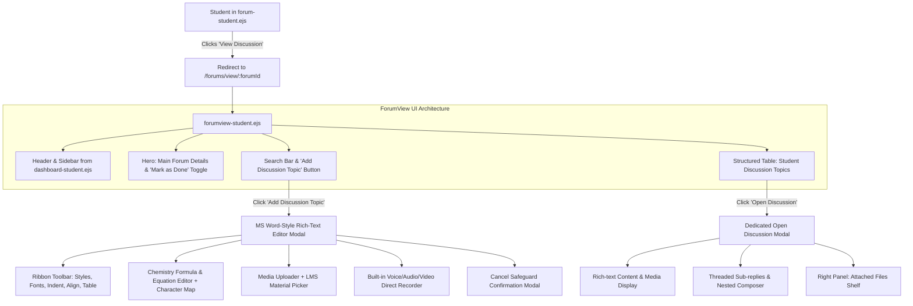
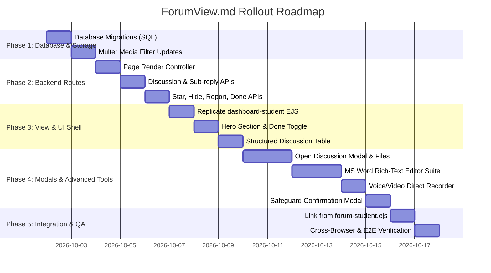

# Comprehensive Implementation Plan: `ForumView.md`
**Target View:** `views/forumview-student.ejs` & Subsystems  
**Target Routing:** `/forums/view/:forumId` & Associated REST Endpoints  
**Context:** Elementa Chemistry LMS — Student Community & Formative Discussion Board  
**Compliance Standard:** Full Layout Parity with `dashboard-student.ejs`, Zero Breaking Changes, Robust Schema Extensions  

---

## 1. Executive Summary & Objective

This implementation plan details the end-to-end design, database schema updates, backend API controllers, and frontend view architecture for **`forumview-student.ejs`** as defined in [`ForumView.md`](file:///c:/Users/althe/Downloads/LMS%20GAME%20ESP32%20SETUP/chemistry_lms_backup%20-%20Copy/ForumView.md).

Currently, when a student visits [`views/forum-student.ejs`](file:///c:/Users/althe/Downloads/LMS%20GAME%20ESP32%20SETUP/chemistry_lms_backup%20-%20Copy/views/forum-student.ejs) and clicks "View Discussion", a lightweight pop-up modal is opened. The new specification transitions this workflow into a dedicated, full-page workspace:
1. **Seamless Navigation & Strict Parity:** Seamless redirect from `forum-student.ejs` to `forumview-student.ejs`, retaining the exact layout, `#sidebar` (`#06091A`), top navigation header, user dropdown, and typography found in [`dashboard-student.ejs`](file:///c:/Users/althe/Downloads/LMS%20GAME%20ESP32%20SETUP/chemistry_lms_backup%20-%20Copy/views/dashboard-student.ejs).
2. **Main Forum Details Hero Section:** Displays teacher prompt, course/subject/topic category, author card, timestamps, and an interactive **"Mark as Done"** completion toggle.
3. **Interactive Search & Action Bar:** Instant real-time filtering (by discussion title, content snippet, contributor) and an **"Add Discussion Topic"** action button.
4. **Structured Discussion Topics Table:** Tabular listing of active student threads with columns for Topic Title, Made By (author + date), Last Reply (latest replier + timestamp), Replies Count, and an Ellipses dropdown (Open, Star, Hide, Report).
5. **Dedicated "Open Discussion" Modal:** Full-view discussion reader with course topic/forum topic breadcrumbs, rich content, embedded media players, threaded parent-to-child nested comments with like/reply/report options, and a **right-side file attachment shelf**.
6. **Advanced MS Word-like Rich-Text Editor Modal:** Complete WYSIWYG authoring suite with typography styling, indent/outdent sub-modals, link insertion with LMS learning materials browser, emoji picker, media insertion (image, audio, video), **built-in audio/video voice recorder**, chemical formula/equation builder, special character map, table configurator, undo/redo stack, and an unsaved changes confirmation safeguard modal.



---

## 2. Database Schema Analysis & Required Migrations

### 2.1 Existing Relational Foundations
- **`forum_topics`**: Stores instructor-created prompts (`forum_id`, `topic_id`, `subject_id`, `teacher_id`, `title`, `forum_content`, `created_at`, `status`).
- **`forum_replies`**: Stores student responses (`reply_id`, `topic_id` [FK to `forum_topics.forum_id`], `user_id`, `parent_reply_id`, `reply_content`, `file_path`, `file_name`, `file_type`, `created_at`).
- **`student_forum_done`**: Tracks individual student completion (`student_id`, `forum_id`, `done_at`).
- **`reply_votes`**: Stores user likes/upvotes on replies (`vote_id`, `reply_id`, `user_id`).

### 2.2 Schema Extensions
To support the feature set specified in `ForumView.md` (topic titles for student threads, personal stars, personal hidden items, direct reports), create migration script `migrations/20261001_forum_view_enhancements.sql`:

```sql
-- ============================================================================
-- Migration: Forum View Enhancements & Student Threading
-- ============================================================================

-- 1. Add reply_title to forum_replies for root student discussion topics
ALTER TABLE `forum_replies`
  ADD COLUMN `reply_title` VARCHAR(255) NULL AFTER `parent_reply_id`,
  ADD KEY `idx_parent_topic` (`topic_id`, `parent_reply_id`);

-- 2. Personal Starred Discussions (Per-Student Bookmark)
CREATE TABLE IF NOT EXISTS `forum_reply_stars` (
  `star_id`     INT(11) NOT NULL AUTO_INCREMENT,
  `user_id`     INT(11) NOT NULL,
  `reply_id`    INT(11) NOT NULL,
  `created_at`  TIMESTAMP NOT NULL DEFAULT CURRENT_TIMESTAMP,
  PRIMARY KEY (`star_id`),
  UNIQUE KEY `uq_user_reply_star` (`user_id`, `reply_id`),
  KEY `fk_star_reply` (`reply_id`),
  CONSTRAINT `fk_star_user` FOREIGN KEY (`user_id`) REFERENCES `users` (`user_id`) ON DELETE CASCADE,
  CONSTRAINT `fk_star_reply` FOREIGN KEY (`reply_id`) REFERENCES `forum_replies` (`reply_id`) ON DELETE CASCADE
) ENGINE=InnoDB DEFAULT CHARSET=utf8mb4 COLLATE=utf8mb4_general_ci;

-- 3. Personal Hidden Discussions ("Hide for Me")
CREATE TABLE IF NOT EXISTS `forum_reply_hidden` (
  `hide_id`     INT(11) NOT NULL AUTO_INCREMENT,
  `user_id`     INT(11) NOT NULL,
  `reply_id`    INT(11) NOT NULL,
  `created_at`  TIMESTAMP NOT NULL DEFAULT CURRENT_TIMESTAMP,
  PRIMARY KEY (`hide_id`),
  UNIQUE KEY `uq_user_reply_hide` (`user_id`, `reply_id`),
  KEY `fk_hide_reply` (`reply_id`),
  CONSTRAINT `fk_hide_user` FOREIGN KEY (`user_id`) REFERENCES `users` (`user_id`) ON DELETE CASCADE,
  CONSTRAINT `fk_hide_reply` FOREIGN KEY (`reply_id`) REFERENCES `forum_replies` (`reply_id`) ON DELETE CASCADE
) ENGINE=InnoDB DEFAULT CHARSET=utf8mb4 COLLATE=utf8mb4_general_ci;

-- 4. Discussion & Reply Moderation Reports
CREATE TABLE IF NOT EXISTS `forum_reports` (
  `report_id`   INT(11) NOT NULL AUTO_INCREMENT,
  `reporter_id` INT(11) NOT NULL,
  `reply_id`    INT(11) NOT NULL,
  `reason`      VARCHAR(100) NOT NULL,
  `details`     TEXT NULL,
  `status`      ENUM('pending', 'reviewed', 'dismissed', 'actioned') NOT NULL DEFAULT 'pending',
  `created_at`  TIMESTAMP NOT NULL DEFAULT CURRENT_TIMESTAMP,
  PRIMARY KEY (`report_id`),
  KEY `fk_report_reply` (`reply_id`),
  KEY `fk_report_user` (`reporter_id`),
  CONSTRAINT `fk_report_user` FOREIGN KEY (`reporter_id`) REFERENCES `users` (`user_id`) ON DELETE CASCADE,
  CONSTRAINT `fk_report_reply` FOREIGN KEY (`reply_id`) REFERENCES `forum_replies` (`reply_id`) ON DELETE CASCADE
) ENGINE=InnoDB DEFAULT CHARSET=utf8mb4 COLLATE=utf8mb4_general_ci;
```

---

## 3. Backend Routes & API Contracts

All student-facing forum routes reside in [`routes/student.js`](file:///c:/Users/althe/Downloads/LMS%20GAME%20ESP32%20SETUP/chemistry_lms_backup%20-%20Copy/routes/student.js).

### 3.1 Primary Page Render Route
- **Route:** `GET /forums/view/:forumId` (alias: `GET /forumview-student/:forumId`)
- **Middleware:** `isAuthenticated` (and verify student is enrolled in the topic's subject class).
- **Data Payload to EJS:**
  * `forum`: Forum topic metadata (`forum_id`, `title`, `forum_content`, `created_at`, `subject_name`, `topic_name`, `teacher_name`, `teacher_pic`, `is_done`).
  * `discussionTopics`: Root discussion topics (`parent_reply_id IS NULL`), joined with:
    - Author details (`first_name`, `last_name`, `profile_pic`, `role`).
    - Sub-reply count (`COUNT(child.reply_id)`).
    - Last reply info (`last_replier_name`, `last_replier_pic`, `last_reply_at`).
    - User flags (`is_starred`, `is_hidden`).
  * `user`: Authenticated student session object.

### 3.2 REST API Endpoints

| Method | Endpoint | Description | Request Body / Query | Response Payload |
|---|---|---|---|---|
| `GET` | `/api/forum-view/:forumId/topics` | Refresh discussion topics list with search/filter | `?search=...&filter=all\|starred` | `{ success: true, topics: [...] }` |
| `POST` | `/api/forum-done` | Toggle completion status | `{ forum_id: 12 }` | `{ success: true, is_done: boolean }` |
| `POST` | `/api/forum-discussion-topic` | Create student discussion topic with rich-text & media | `multipart/form-data`: `forum_id`, `reply_title`, `reply_content`, `file` | `{ success: true, reply_id: 45 }` |
| `GET` | `/api/forum-discussion/:replyId` | Get full discussion modal details, threaded tree & files | None | `{ success: true, thread: {...}, subReplies: [...], files: [...] }` |
| `POST` | `/api/forum-subreply` | Post a threaded nested reply | `multipart/form-data`: `forum_id`, `parent_reply_id`, `reply_content`, `file` | `{ success: true, reply_id: 46 }` |
| `POST` | `/api/forum-reply/:replyId/star` | Toggle star on a discussion topic | None | `{ success: true, is_starred: boolean }` |
| `POST` | `/api/forum-reply/:replyId/hide` | Hide a discussion topic for current user | None | `{ success: true, is_hidden: true }` |
| `POST` | `/api/forum-reply/:replyId/report` | Report discussion or reply | `{ reason: string, details: string }` | `{ success: true }` |
| `POST` | `/api/forum-reply/:replyId/like` | Toggle upvote on a reply | None | `{ success: true, liked: boolean, like_count: number }` |
| `GET` | `/api/forum/repository-files` | Browse LMS learning materials to insert links | `?subject_id=...` | `{ files: [{ id, title, file_path, file_type }] }` |

### 3.3 Multer Configuration Extension
In [`app.js`](file:///c:/Users/althe/Downloads/LMS%20GAME%20ESP32%20SETUP/chemistry_lms_backup%20-%20Copy/app.js) and `routes/student.js`, extend `checkForumFile` regex filter to support browser audio/video recordings and common science media:
```javascript
const allowed = /jpeg|jpg|png|gif|webp|svg|pdf|doc|docx|ppt|pptx|xls|xlsx|txt|mp4|mov|webm|mp3|wav|ogg|m4a/;
```

---

## 4. UI/UX Specifications (`views/forumview-student.ejs`)

### 4.1 Strict Layout Replication of `dashboard-student.ejs`
- **Shell Structure:**
  * Same Google Font import: `Plus Jakarta Sans`.
  * Background: `bg-gradient-to-br from-slate-50 via-white to-indigo-50/30 text-slate-900 min-h-screen`.
  * Mobile overlay: `#sidebarOverlay` with `toggleSidebar()`.
  * Sidebar: `#sidebar` with background `#06091A`, brand logo (`Elem` cyan-400 + `enta` white), subtitle "Student Portal".
  * Nav items: "Home", "Dashboard", "My Subjects", "Events", **"Forums" (with `.nav-active` styling: cyan gradient + shadow)**, "Leaderboards", "Log Out".
  * Main Container: `#mainContent` with `transition: margin-left 0.3s cubic-bezier(0.4, 0, 0.2, 1);`.
  * Header: Fixed top bar (`h-20 bg-white/95 backdrop-blur-md border-b border-slate-200/80 fixed top-0 left-0 right-0 md:left-64 z-40`), sidebar hamburger button, greeting "Welcome, <%= user.first_name %>!", notification bell with live counter, and profile avatar dropdown with "View Profile" & "Log Out".
  * Footer / Script Partials: Notification slide-over, universal modal scripts (`modal-core.js`, `soundManager.js`).

---

### 4.2 Top Hero: Main Forum Details & "Mark as Done"

Located at top of the page body with responsive container styling:
- **Topic Context Breadcrumb:** Course Subject badge (e.g. `General Chemistry 1`) & Topic Category badge (e.g. `Thermochemistry & Calorimetry`).
- **Forum Title:** Prominent `h1` in `text-2xl md:text-3xl font-black text-slate-900 tracking-tight`.
- **Mark as Done Button (Positioned neatly next to title):**
  * When undone: Bordered slate/amber button `inline-flex items-center gap-2 px-4 py-2 rounded-xl text-xs font-bold border border-slate-200 hover:border-emerald-500 hover:bg-emerald-50 text-slate-600 transition shadow-xs`.
  * When done: `inline-flex items-center gap-2 px-4 py-2 rounded-xl text-xs font-extrabold bg-emerald-600 text-white shadow-md shadow-emerald-200 transition`.
  * Interactivity: Asynchronous fetch to `/api/forum-done` with optimistic UI update and sound manager pop effect.
- **Author Information Bar:**
  * Teacher avatar with ring styling.
  * Posted by `Prof. [Last Name]` (or full name).
  * Calendar icon with formatted date & time: `October 1, 2026 · 10:30 AM`.
  * Status indicator: Solved / Unresolved / Active.
- **Detailed Content Card:**
  * Rich HTML rendering of `forum.forum_content`.
  * Collapsible toggle for lengthy lecture prompts (`Show More / Show Less`).

---

### 4.3 Interactive Search & Action Bar

Positioned immediately below the hero card:
- **Search Bar:**
  * Styled search container with search icon, clear button (`✕`), and placeholder: `"Search discussion topics or contributors..."`.
  * Client-side debounced instant filtering + server-side fallback.
- **Quick Filters:**
  * Filter pills: `All Discussions`, `Starred Only`, `Most Active`.
- **"Add Discussion Topic" Action Button:**
  * High-visibility CTA button: `bg-gradient-to-r from-cyan-600 to-indigo-600 hover:from-cyan-500 hover:to-indigo-500 text-white font-extrabold text-xs md:text-sm px-5 py-3 rounded-2xl shadow-lg shadow-cyan-500/20 hover:shadow-cyan-500/35 hover:-translate-y-0.5 transition-all flex items-center gap-2`.
  * Icon: `<i class="fas fa-plus-circle"></i>`.
  * Triggers the MS Word-like Rich-Text Editor modal.

---

### 4.4 Structured Discussion Topics Table

Formatted as an accessible data table on desktop with responsive card fallback on mobile:
- **Columns:**
  1. **Topic Title:**
     * Prominent clickable title that opens the discussion modal.
     * Content snippet (truncated 1-line preview).
     * Visual badges: "Starred" gold icon, "Has Media" attachment paperclip.
  2. **Made By:**
     * Author avatar (student profile picture or default).
     * Author full name.
     * Creation timestamp (`MMM D, YYYY · h:mm A`).
  3. **Last Reply:**
     * Avatar of the last student/teacher to interact with the thread.
     * Last replier's name + relative time (`5m ago`, `2h ago`).
     * If no replies yet: Subtle italic indicator (`No replies yet`).
  4. **Replies Count:**
     * High-contrast counter badge: `inline-flex items-center gap-1.5 px-3 py-1 rounded-xl bg-slate-100 font-extrabold text-xs text-slate-700`.
  5. **Ellipses Actions (`...` dropdown button):**
     * **Open Discussion:** Triggers the dedicated Open Discussion modal.
     * **Star this Discussion:** Toggles user bookmark (updates gold star badge).
     * **Hide for Me:** Hides row with smooth fade-out animation and an undo snackbar toast.
     * **Report this Discussion:** Opens dedicated report modal with reason selector.
- **Empty State:**
  * Custom graphic / icon (`fa-comments`), friendly prompt: *"No discussions started yet. Be the first to start a conversation!"*, and a quick "Start Discussion" button.

---

### 4.5 Dedicated "Open Discussion" Modal

A wide, ergonomic split-view modal (`max-w-6xl w-full max-h-[92vh] flex flex-col rounded-3xl bg-white shadow-2xl overflow-hidden`):
- **Header:**
  * Hierarchy breadcrumbs: `[Subject] > [Forum Topic] > [Student Discussion Title]`.
  * Close modal button (`✕` and `Esc` key listener).
- **Body Split Layout:**
  * **Left / Center Main Thread Area (70% width):**
    - Author banner (student avatar, name, posted date).
    - Original discussion title and full rich-text content.
    - Inline media attachments (image gallery with zoom preview, HTML5 audio player for voice notes, video player for clips).
    - **Threaded Parent-to-Child Comments:**
      * Visual tree lines showing nesting levels.
      * Sub-reply cards featuring author name, timestamp, and formatted reply text.
      * Sub-reply action bar: **Like button** (with active heart/thumbs up icon and live counter), **Reply button** (reveals inline targeted reply box), **Ellipses menu** (Report comment).
      * Nested Reply Box: Quick rich-text input with attachment clip and "Post Reply" button.
  * **Right Panel: Uploaded Files & Media Shelf (30% width):**
    - Clean dedicated panel: *"Files & Resources (N)"*.
    - List of all attachments uploaded in this thread:
      * File icon (PDF, DOCX, PNG, MP3, etc.).
      * File name & size.
      * Quick "Download" button and in-app "Preview" button.
    - Contributor summary list (avatars of everyone participating in this thread).

---

### 4.6 Advanced MS Word-Style Rich-Text Editor Modal

Designed for comprehensive academic and chemical authoring:
- **Reply Topic Title Input:** Required text input field with floating label and character counter.
- **Top Ribbon Toolbar (Microsoft Word Aesthetic):**
  * **Styles Selector:** Paragraph, Heading 1, Heading 2, Heading 3, Code block, Quote.
  * **Font Formatting:** Bold (`Ctrl+B`), Italic (`Ctrl+I`).
  * **Lists:** Unordered bulleted list (`<ul>`), Ordered numeric list (`<ol>`).
  * **Indentation:** Indent, Outdent, and Custom Indentation Sub-modal (adjust margin px / rem).
  * **Links & Repository Files:**
    - Link insertion dialog: URL, display text, open in new tab.
    - **Repository File Browser:** Sub-modal allowing students to link directly to course learning materials or handouts.
  * **Emoji Picker:** Searchable popover with standard emojis and science/study symbols.
  * **Media Insertion Sub-Modals:**
    - **Images:** File upload drag-and-drop or Web image URL + caption.
    - **Audio:** File upload or Web URL.
    - **Video:** File upload or YouTube / video embed URL.
    - **Direct Recording Capabilities (Voice & Video):**
      * Integrated HTML5 `MediaRecorder` widget.
      * "Record Voice Note" button with microphone permission check, audio waveform visualizer, pause/resume, timer, playback preview, and direct attach to post.
      * "Record Video Clip" button with live camera preview.
- **Expandable Toolbar ("More Utilities" toggle):**
  * Underline (`Ctrl+U`), Strike-through.
  * **Subscript (`X₂`) & Superscript (`X²`)**: Essential for chemical notation ($H_2O$, $SO_4^{2-}$).
  * **Text Alignment:** Left, Center, Right, Justify.
  * **Equation Editor Sub-Modal:** Quick formula builder for chemical equations (reactants, reaction arrows $\rightarrow$, $\rightleftharpoons$, ionic charges, phases $(s), (l), (g), (aq)$).
  * **Character Map Modal:** Special chemistry and math symbols ($\alpha, \beta, \gamma, \Delta, \Omega, \pi, \pm, \approx, \infty, ^\circ\text{C}$).
  * **Table Configuration Modal:** Visual grid picker (up to 8x8) to insert responsive styled HTML tables with alternating row colors.
  * **Undo / Redo:** Full history tracking stack with `Ctrl+Z` / `Ctrl+Y` shortcuts.
- **Editable Content Surface:**
  * Clean, borderless `contenteditable="true"` canvas with a min-height of 250px, placeholder text, and spellcheck.
- **Bottom Footer Controls & Safeguard Modal:**
  * Attached file chips bar showing selected files/recordings with delete `✕` badges.
  * "Post to Forum" submit button with loading spinner.
  * "Cancel" button:
    * Intercepted if content is not empty: launches **Safeguard Confirmation Modal**:
      *"Discard unsaved discussion topic? Any text, equations, or recordings you've added will be permanently lost."*
      * Options: `Keep Editing` (closes confirmation) or `Discard Changes` (resets form and closes editor).

---

## 5. Step-by-Step Implementation Phases



### Phase 1: Database Migrations & Media Storage Configuration
1. Create and execute [`migrations/20261001_forum_view_enhancements.sql`](file:///c:/Users/althe/Downloads/LMS%20GAME%20ESP32%20SETUP/chemistry_lms_backup%20-%20Copy/migrations/20261001_forum_view_enhancements.sql):
   - Add `reply_title` column to `forum_replies`.
   - Create `forum_reply_stars`, `forum_reply_hidden`, `forum_reports` tables with foreign keys and cascading deletes.
2. Update upload configuration in [`app.js`](file:///c:/Users/althe/Downloads/LMS%20GAME%20ESP32%20SETUP/chemistry_lms_backup%20-%20Copy/app.js) and `routes/student.js`:
   - Extend allowed extensions to include `.webm`, `.wav`, `.mp3`, `.ogg`, `.svg`.
   - Verify upload directory permissions for `public/forum_uploads` or `files/`.

### Phase 2: Backend Endpoints & Query Layer
1. Add `GET /forums/view/:forumId` to [`routes/student.js`](file:///c:/Users/althe/Downloads/LMS%20GAME%20ESP32%20SETUP/chemistry_lms_backup%20-%20Copy/routes/student.js):
   - Fetch forum topic details, subject name, topic name, teacher details.
   - Fetch completion status from `student_forum_done`.
   - Fetch root discussion topics (`parent_reply_id IS NULL`), calculating reply count, latest reply author/timestamp, and star/hide state.
2. Add JSON API endpoints:
   - `POST /api/forum-discussion-topic` (Multer + DB insert).
   - `GET /api/forum-discussion/:replyId` (Hierarchical tree aggregation + file list).
   - `POST /api/forum-subreply` (Threaded comment insertion).
   - `POST /api/forum-reply/:replyId/star` (Bookmark toggle).
   - `POST /api/forum-reply/:replyId/hide` (Hide toggle).
   - `POST /api/forum-reply/:replyId/report` (Report insertion).
   - `POST /api/forum-reply/:replyId/like` (Upvote toggle via `reply_votes`).
   - `GET /api/forum/repository-files` (Class materials listing for link inserter).

### Phase 3: Primary View Shell & Main Content Table
1. Create [`views/forumview-student.ejs`](file:///c:/Users/althe/Downloads/LMS%20GAME%20ESP32%20SETUP/chemistry_lms_backup%20-%20Copy/views/forumview-student.ejs):
   - Copy exact sidebar, responsive CSS rules, fonts, and header from [`views/dashboard-student.ejs`](file:///c:/Users/althe/Downloads/LMS%20GAME%20ESP32%20SETUP/chemistry_lms_backup%20-%20Copy/views/dashboard-student.ejs).
   - Ensure the "Forums" sidebar item contains `.nav-active`.
2. Construct Hero Section:
   - Topic breadcrumb chips, teacher avatar, title, and formatted prompt content.
   - Interactive "Mark as Done" button with live status toggling.
3. Build Interactive Tools Bar:
   - Search input, filter buttons, and "Add Discussion Topic" CTA button.
4. Build Structured Discussion Table:
   - Columns: Title & snippet, Made By, Last Reply, Replies Count, Ellipses action menu.
   - Wire dropdown actions: Open, Star, Hide, Report.

### Phase 4: Threaded Discussion Modal ("Open Discussion")
1. Implement `#discussionDetailModal` in `forumview-student.ejs`:
   - Left side: Full discussion body, inline media players, nested comment tree, quick inline sub-reply form.
   - Right side: Attached files shelf with download/preview triggers, participant avatars.
2. Wire up like toggle, sub-reply submission, and comment reporting.

### Phase 5: MS Word-Style Rich-Text Editor Suite
1. Build `#newTopicModal` in `forumview-student.ejs`:
   - Ribbon toolbar layout with icons (FontAwesome 6).
   - Core formatting via `document.execCommand` / Selection Range API (Bold, Italic, Underline, Strikethrough, Subscript, Superscript, Alignments, Lists, Indents).
   - Popovers / Sub-modals:
     * Link inserter + Repository file browser.
     * Emoji picker palette.
     * Media insertion dialogs (Images, Audio, Video).
     * Character map modal (Chemistry symbols $\alpha, \beta, \Delta, \rightarrow$, etc.).
     * Equation editor (chemical formula composer).
     * Table configuration modal (rows $\times$ cols generator).
2. Direct Audio/Video Voice Recorder:
   - Use `navigator.mediaDevices.getUserMedia` + `MediaRecorder`.
   - Audio visualizer with timer and pause/resume.
   - Output `Blob` appended to `FormData` on submit.
3. Safeguard Confirmation Modal:
   - Detect non-empty title or editor content on "Cancel" or backdrop click.
   - Prompt confirmation before destroying user input.

### Phase 6: Integration, Testing & Validation
1. Update [`views/forum-student.ejs`](file:///c:/Users/althe/Downloads/LMS%20GAME%20ESP32%20SETUP/chemistry_lms_backup%20-%20Copy/views/forum-student.ejs):
   - Modify the "View Discussion" button from opening a modal to navigating directly:
     ```html
     <a href="/forums/view/<%= forum.forum_id %>" class="flex items-center gap-2 ...">
         <i class="fas fa-comments text-[10px]"></i> View Discussion
     </a>
     ```
2. Verify all user workflows:
   - Mark as done updates database and UI dynamically.
   - Creating a discussion topic posts rich text, files, and voice recordings.
   - Opening a discussion renders nested sub-replies and the right-side files panel.
   - Ellipses actions (Star, Hide, Report) function with live visual feedback.
   - Cancel confirmation modal intercepts accidental clicks.

---

## 6. Verification & Quality Checklist

- [ ] **Visual Parity:** Sidebar and header match `dashboard-student.ejs` pixel-for-pixel; responsive sidebar operates correctly on mobile devices.
- [ ] **Data Isolation:** Students can only view discussions for subjects they are actively enrolled in.
- [ ] **Media Playback:** Images open in clean lightboxes; `.mp3`/`.wav`/`.webm` audio voice notes play natively in-browser without format errors.
- [ ] **Chemical Formulas:** Subscripts ($H_2O$) and superscripts ($Fe^{3+}$) format accurately both in the editor and in the rendered thread view.
- [ ] **Thread Integrity:** Sub-replies attach strictly to their valid parent reply; deleted or hidden replies do not break the rendering tree.
- [ ] **Form Safeguard:** Pressing Cancel or clicking outside an active editor triggers the discard confirmation modal to prevent data loss.
- [ ] **No Regression:** Existing routes in `student.js`, `teacher.js`, and `elementaRoutes.js` remain completely undisturbed.
