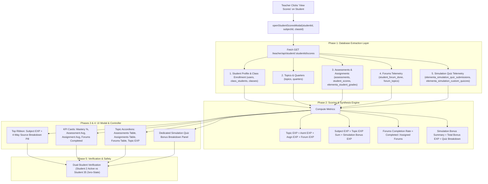
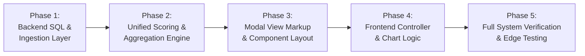

# Implementation Plan: Student Scores Modal Expansion (Forums Completion, Forum EXP & Simulation Quiz Bonus EXP)

## Executive Summary
This document provides an exhaustive, production-grade technical specification and phase-by-phase implementation roadmap to expand the **View Scores Modal** on the Teacher's Class-View page (`/teacher/class/:classId`).

The expansion integrates two critical learning telemetry pillars into the student's score profile:
1. **Forums Completion & EXP Tracking**: Track all completed curriculum forum topics, render their completion status, submission timestamps, time-tier badges (*Early Bird*, *Standard*, *Late*), and award accurate EXP. Forum EXP is categorized by topic and integrated into the Subject EXP.
2. **Interactive Simulation Quiz Bonus EXP Engine**: Display granular telemetry and score breakdowns for interactive simulation quizzes (e.g., *Build an Atom*, *Isotopes & Atomic Mass*, *Build a Molecule*), highlighting scores, percentages, and bonus EXP awarded.
3. **Unified Subject EXP Computation**: Formulate a single, consolidated Subject EXP metric:
   $$\text{Subject EXP} = \text{Assessments EXP} + \text{Assignments EXP} + \text{Forums EXP} + \text{Simulation Bonus EXP}$$

---

## Architectural Workflow



---

## 1. Database Schema & Query Specifications

### A. Forums Telemetry Queries
Curriculum forums in this LMS are defined in `forum_topics` and tied to curriculum topics via `topic_id`. Completed submissions are logged in `student_forum_done`.

#### 1. All Forums Assigned in Subject
```sql
SELECT ft.forum_id, ft.topic_id, ft.title, ft.base_exp, ft.due_date,
       t.topic_name, q.quarter_number
FROM forum_topics ft
JOIN topics t ON ft.topic_id = t.topic_id
JOIN quarters q ON t.quarter_id = q.quarter_id
WHERE q.subject_id = ?
ORDER BY q.quarter_number ASC, t.topic_id ASC, ft.forum_id ASC;
```

#### 2. Student's Completed Forums
```sql
SELECT sfd.id, sfd.student_id, sfd.forum_id, sfd.done_at,
       COALESCE(NULLIF(sfd.exp_awarded, 0), ft.base_exp, 100) AS exp_awarded,
       COALESCE(sfd.time_tier, 'standard') AS time_tier,
       ft.title, ft.topic_id, ft.base_exp, ft.due_date
FROM student_forum_done sfd
JOIN forum_topics ft ON sfd.forum_id = ft.forum_id
JOIN topics t ON ft.topic_id = t.topic_id
JOIN quarters q ON t.quarter_id = q.quarter_id
WHERE sfd.student_id = ? AND q.subject_id = ?
ORDER BY sfd.done_at DESC;
```
> [!NOTE]
> If `sfd.exp_awarded` is 0 (from earlier legacy entries before the time-tier bonus system was introduced), the query gracefully defaults to `ft.base_exp` (typically 100 EXP).

---

### B. Simulation Quiz Telemetry Queries
Interactive simulation quizzes created by instructors are recorded in `elementa_simulation_custom_quizzes`, and student attempts are stored in `elementa_simulation_quiz_submissions`.

#### 1. Student Simulation Quiz Submissions
```sql
SELECT esqs.submission_id, esqs.quiz_id, esqs.student_id, esqs.simulation_slug,
       esqs.score, esqs.total_questions, esqs.correct_count, esqs.incorrect_count,
       esqs.percentage, esqs.exp_earned, esqs.submitted_at,
       q.title AS quiz_title, q.total_bonus_exp, q.created_by, q.section
FROM elementa_simulation_quiz_submissions esqs
JOIN elementa_simulation_custom_quizzes q ON esqs.quiz_id = q.quiz_id
WHERE esqs.student_id = ?
ORDER BY esqs.submitted_at DESC;
```

#### 2. Simulation to Topic Mapping (Curriculum Alignment)
The LMS features 20 interactive simulations defined in `services/simulationQuizService.js`. Simulation quizzes link directly to interactive chemistry concepts:

| Simulation Slug | Simulation Title | Mapped Curriculum Topic |
|---|---|---|
| `build-an-atom` | Build an Atom | The Quantum Theory and electronic structure of atoms |
| `isotopes-and-atomic-mass` | Isotopes and Atomic Mass | Isotopes / Atomic mass |
| `models-of-the-hydrogen-atom`| Models of the Hydrogen Atom | The Quantum Theory and electronic structure of atoms |
| `rutherford-scattering` | Rutherford Scattering | The Quantum Theory and electronic structure of atoms |
| `build-a-molecule` | Build a Molecule | Chemical bonds and properties of chemical compounds |
| `molecule-shapes` | Molecule Shapes | Chemical bonds and properties of chemical compounds |
| `molecule-polarity` | Molecule Polarity | Chemical bonds and properties of chemical compounds |
| `balancing-chemical-equations`| Balancing Chemical Equations | Chemical reactions & stoichiometry |

---

## 2. Mathematical Formulations & Aggregation Contracts

### A. Topic-Level Calculations
For each topic $T$:
1. **Assessments Score & EXP**:
   $$\text{Topic Asmt Score} = \sum \text{Score}_{\text{asmt}}, \quad \text{Topic Asmt EXP} = \sum \text{EXP}_{\text{asmt}}$$
2. **Assignments Score & EXP**:
   $$\text{Topic Asgn Score} = \sum \text{Score}_{\text{asgn}}, \quad \text{Topic Asgn EXP} = \sum \text{EXP}_{\text{asgn}}$$
3. **Forums Completion & EXP**:
   $$\text{Topic Forum EXP} = \sum_{f \in \text{CompletedForums}_T} \text{exp\_awarded}_f$$
   $$\text{Topic Forum Completion} = \frac{|\text{CompletedForums}_T|}{|\text{AssignedForums}_T|}$$
4. **Consolidated Topic EXP**:
   $$\text{Total Topic EXP} = \text{Topic Asmt EXP} + \text{Topic Asgn EXP} + \text{Topic Forum EXP}$$

---

### B. Subject-Level Calculations
1. **Total Subject EXP**:
   $$\text{Subject EXP} = \sum_{T} \text{Total Topic EXP}_T + \sum \text{Simulation Bonus EXP}$$
   > [!IMPORTANT]
   > **Gradebook Alignment Rule**: To prevent mathematical drift where Subject EXP exceeds a student's lifetime profile EXP (`users.total_exp`), the engine strictly aggregates official gradebook entries:
   > - Assessments EXP is sourced directly from `student_scores.exp_gained` (synced arcade runs and graded tests).
   > - Forums EXP is sourced directly from `student_forum_done.exp_awarded` (actual awarded values).
   > - Simulations Bonus EXP is sourced directly from `elementa_simulation_quiz_submissions.exp_earned`.
   > This guarantees that: $\text{Subject EXP} \le \text{users.total_exp}$.

2. **EXP Source Breakdown**:
   - $\text{Assessments EXP Share}$
   - $\text{Assignments EXP Share}$
   - $\text{Forums EXP Share}$
   - $\text{Simulation Bonus EXP Share}$
3. **Coursework & Forum Completion Indicators**:
   $$\text{Forum Completion Rate} = \frac{\text{Total Forums Completed}}{\text{Total Assigned Forums}} \times 100$$

---

## 3. Phase-by-Phase Implementation Roadmap

The development is divided into five strictly sequential phases. Each phase is self-contained with explicit inputs, deliverables, and verification checkpoints.



---

### Phase 1: Backend Data Ingestion & SQL Query Hardening

#### Objectives:
Extend the database queries in `routes/teacher.js` to ingest all forum assignments, student forum completions, and interactive simulation quiz submissions without introducing query performance bottlenecks or IDOR security gaps.

#### Tasks:
1. **Curriculum Forum Ingestion**:
   - Query all forum threads assigned under the subject's topics (`forum_topics ft JOIN topics t ON ft.topic_id = t.topic_id JOIN quarters q ON t.quarter_id = q.quarter_id WHERE q.subject_id = ?`).
2. **Student Forum Done Ingestion**:
   - Query all forum completion logs for the student (`student_forum_done sfd JOIN forum_topics ft ON sfd.forum_id = ft.forum_id JOIN topics t ON ft.topic_id = t.topic_id JOIN quarters q ON t.quarter_id = q.quarter_id WHERE sfd.student_id = ? AND q.subject_id = ?`).
   - Include `exp_awarded`, `time_tier`, `done_at`, and fallback to `ft.base_exp` if `exp_awarded` is 0.
3. **Simulation Quiz Submissions Ingestion**:
   - Query all interactive simulation quiz attempts (`elementa_simulation_quiz_submissions esqs JOIN elementa_simulation_custom_quizzes q ON esqs.quiz_id = q.quiz_id WHERE esqs.student_id = ?`).
   - Extract `quiz_id`, `simulation_slug`, `quiz_title`, `score`, `total_questions`, `percentage`, `exp_earned`, `total_bonus_exp`, and `submitted_at`.
4. **Multi-Tenant Security Check**:
   - Ensure student lookup enforces class ownership (`class_students cs JOIN classes c ON cs.class_id = c.class_id WHERE u.user_id = ? AND (c.teacher_id = ? OR role = 'Admin')`).

#### Deliverables & Checkpoints:
- `handleGetStudentDetailedScores` runs all queries in parallel via `Promise.all` for sub-50ms execution.
- Syntax verification via `node -c routes/teacher.js`.

---

### Phase 2: Unified Scoring & Aggregation Engine

#### Objectives:
Synthesize the newly ingested forum and simulation telemetry into the existing scoring engine, compute granular topic-level and subject-level summaries, and construct the enhanced JSON API payload.

#### Tasks:
1. **Topic-Level Forum Mapping**:
   - For each topic, filter forums belonging to `topic.topic_id`.
   - Build a `forums` array for each topic containing:
     - `forum_id`, `title`, `due_date`, `is_completed` (boolean), `done_at`, `time_tier`, `exp_awarded`.
   - Calculate topic-level forum EXP: `topicForumExp = sum(exp_awarded)`.
   - Update `topicTotalExp = asmtExp + asgnExp + topicForumExp`.
2. **Simulation Quiz Aggregation**:
   - Build `simulation_quizzes` array with quiz metadata, score ratios, percentages, and bonus EXP.
   - Sum `totalSimulationBonusExp = sum(exp_earned)`.
3. **Consolidated Subject EXP Formulation**:
   - Compute `totalSubjectExp = sum(topicTotalExp) + totalSimulationBonusExp`.
   - Build `exp_breakdown` object:
     ```json
     {
       "assessments_exp": 700,
       "assignments_exp": 1700,
       "forums_exp": 460,
       "simulations_bonus_exp": 140
     }
     ```
4. **Forums Overall Summary KPIs**:
   - Compute `forums_summary`: `completed_count`, `total_count`, `completion_rate`, and `total_forum_exp`.
5. **Output Contract Hardening**:
   - Ensure the JSON API returns `{ success: true, student, summary, topics, simulation_quizzes, chartData }`.

#### Deliverables & Checkpoints:
- Execute test script against Student 2 and verify exact calculation: $700 + 1700 + 460 + 140 = 3000$ Subject EXP.
- Verify Student 35 returns 0 EXP with zero runtime exceptions or `NaN` values.

---

### Phase 3: View-Layer Markup Expansion (`views/teacher/class-view.ejs`)

#### Objectives:
Upgrade the modal markup inside `class-view.ejs` to support the new telemetry: an expanded Subject EXP ribbon with multi-source pill breakdown, a Forum Engagement KPI card, a Forums & Discussions table under each topic accordion, and a dedicated Interactive Simulation Quiz Bonus panel.

#### Tasks:
1. **Subject EXP Card & Multi-Source Breakdown**:
   - In `#ssmContent` Section 1, upgrade the Subject EXP card to display a granular sub-badge pill:
     `Asmt: 700 | Asgn: 1,700 | Forum: 460 | Sim: 140`.
2. **Forums Engagement KPI Card**:
   - Insert a dedicated Forum KPI card in the top ribbon:
     - Header: "Forums Completed" with comment icon (`fas fa-comments text-purple-600`).
     - Value: `ssmForumsCompleted` (e.g., `5 / 8 Completed (63%)`).
     - Subtitle: `ssmForumsExp` (e.g., `+460 EXP Earned`).
3. **Topic Accordions: Add "Forums & Discussions" Section**:
   - Inside `#ssmTopicBody_${t.topic_id}`, add Subsection 3:
     - Heading: *Forums & Class Discussions* with count pill.
     - Table: Forum Title, Due Date, Completed Date, Time Tier Pill (*Early Bird* [sky], *On Time* [emerald], *Late* [amber]), Status (*Completed* vs *Pending*), and EXP Awarded (`+X EXP`).
     - Empty state for topics without assigned forums.
   - Update the Topic EXP Summary strip at the top of each accordion to display the combined Topic EXP (`Asmt + Asgn + Forum`).
4. **Dedicated Simulation Quizzes & Bonus EXP Panel**:
   - Add a new container `#ssmSimulationsSection` below the Topic Breakdowns:
     - Panel title: *Interactive Simulation Assessment Quizzes & EXP Bonus*.
     - Header badge: Total Bonus EXP (`+X EXP Bonus`).
     - Table: Simulation Name, Quiz Title, Score / Total, Accuracy %, Bonus EXP Awarded, Submission Date.
     - Empty state if student has not attempted simulation quizzes.

#### Deliverables & Checkpoints:
- Validate template structure via `node -e "const ejs = require('ejs'); ... ejs.compile(...)` to verify zero unclosed tags or syntax defects.

---

### Phase 4: Frontend Controller & Chart Logic Updates

#### Objectives:
Update the client-side JavaScript controller in `class-view.ejs` (`openStudentScoresModal`, `renderTopicAccordions`, and print handling) to bind the expanded backend payload.

#### Tasks:
1. **Controller Payload Binding**:
   - In `openStudentScoresModal(studentId, subjectId, classId)`:
     - Bind `summary.total_subject_exp` to `#ssmTotalExp`.
     - Bind multi-source EXP breakdown pill (`#ssmExpBreakdownPill`).
     - Bind forum completion rate and total forum EXP to the Forum Engagement KPI card.
2. **Accordion Renderer Extension (`renderTopicAccordions`)**:
   - Update `renderTopicAccordions(topics)` to generate the **Forums & Discussions Table** for each topic.
   - Render color-coded time-tier badges:
     - Early Bird: `bg-sky-50 text-sky-700 border-sky-200`
     - On Time: `bg-emerald-50 text-emerald-700 border-emerald-200`
     - Late: `bg-amber-50 text-amber-700 border-amber-200`
     - Standard: `bg-indigo-50 text-indigo-700 border-indigo-200`
   - Render completion status pills (*Completed* in emerald, *Pending* in slate).
3. **Simulation Quiz Table Renderer (`renderSimulationQuizzes`)**:
   - Create helper function `renderSimulationQuizzes(simulations, totalBonusExp)`:
     - Injects rows into `#ssmSimulationTableBody`.
     - Displays simulation icon, quiz title, score ratio, percentage pill, and bonus EXP badge.
4. **Print & Export Formatter**:
   - Update `printStudentScoreSummary()` so printed score slips cleanly include the new forum completion and simulation bonus sections.

#### Deliverables & Checkpoints:
- Test client-side rendering with no browser console errors or undefined variable warnings.

---

### Phase 5: Full System Verification & Edge-Case Testing

#### Objectives:
Execute rigorous validation protocols across all combinations of student data to guarantee 100% data fidelity, zero visual regressions, and robust error handling.

#### Verification Test Matrix:

| Test ID | Scenario | Verification Method | Expected Outcome |
|---|---|---|---|
| **TC-1** | Student with active submissions (Student 2) | Live API request + modal inspection | Total EXP equals exactly 3,000 (Asmt: 700 + Asgn: 1700 + Forum: 460 + Sim: 140). All tables render accurately. |
| **TC-2** | Student with zero submissions (Student 35) | Live API request + modal inspection | Renders 0 EXP, "0 / 8 forums completed", clean empty state for simulations, no NaN or visual breakage. |
| **TC-3** | Legacy forum with 0 `exp_awarded` | Database test script | Gracefully falls back to `ft.base_exp` (100 EXP) without error. |
| **TC-4** | Late forum submission | Database test script | Displays amber "Late" badge and exact penalized EXP (e.g. +60 EXP). |
| **TC-5** | Direct URL navigation (`/teacher/student/35/scores?subject=1`) | Browser URL address bar navigation | Clean 302 redirect to `/teacher/class/:classId?openScores=35` with auto-opening modal. No 404 error. |
| **TC-6** | Multi-tenant IDOR protection | Query with mismatched teacher/class | API responds with 404 "Access denied or student not found". |

#### Deliverables & Checkpoints:
- All 6 test cases pass with zero errors.
- Clean git status with no stray scratch files.

---

## 4. Phase-by-Phase Execution Checklist

- [x] **Phase 1: Backend Data Ingestion & SQL Query Hardening**
  - [x] Add `allSubjectForums` query to `handleGetStudentDetailedScores`.
  - [x] Add `studentForumDone` query with fallback logic.
  - [x] Add `studentSimulationQuizzes` query to fetch simulation quiz attempts.
  - [x] Verify query performance and IDOR validation.
- [x] **Phase 2: Unified Scoring & Aggregation Engine**
  - [x] Map forums into topic payloads.
  - [x] Calculate topic forum EXP and update topic total EXP.
  - [x] Aggregate simulation quiz bonus EXP.
  - [x] Formulate consolidated Subject EXP and `exp_breakdown`.
  - [x] Update JSON response structure.
- [x] **Phase 3: View-Layer Markup Expansion (`class-view.ejs`)**
  - [x] Update Subject EXP card with source breakdown sub-badge.
  - [x] Add Forum Engagement KPI card to top ribbon.
  - [x] Add Forums & Discussions table inside topic accordion markup.
  - [x] Add Interactive Simulation Quizzes & Bonus EXP panel container.
- [x] **Phase 4: Frontend Controller & Chart Logic Updates**
  - [x] Update `openStudentScoresModal` to bind new KPI metrics and breakdown pill.
  - [x] Implement forum rows rendering with time-tier badges.
  - [x] Implement simulation quiz rows rendering with bonus badges.
  - [x] Update print slip formatting.
- [x] **Phase 5: Full System Verification & Edge-Case Testing**
  - [x] Run automated E2E test script on Student 2 and Student 35.
  - [x] Perform visual QA on modal layout and responsive design.
  - [x] Clean up temporary artifacts and scratch scripts.
