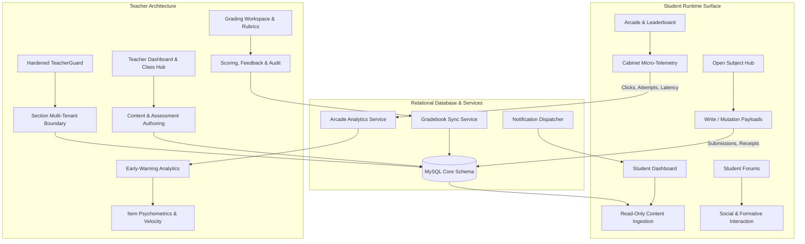
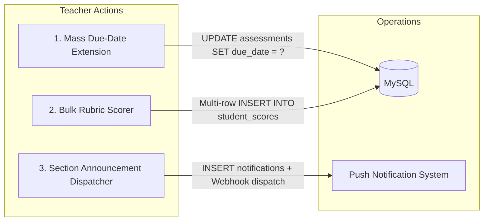

# ELEMENTA LMS: FULL-STACK REVERSE-ENGINEERING & DUAL-SIDED PORTAL ARCHITECTURE SPECIFICATION
**Target System:** Elementa Chemistry LMS & Arcade Cabinet Engine  
**Workspace:** `chemistry_lms_backup - Copy`  
**Execution Context:** Production Audit & Teacher Access Level Parity Scaffolding  
**Compliance Standard:** Zero Hallucination, Non-Breaking Backward Compatibility, Strict Multi-Tenant Section Isolation

---

## I. EXECUTIVE MISSION & ARCHITECTURAL BASELINE

The Student Access Level in Elementa LMS is fully operational across view layers, REST and WebSocket endpoints, session state stores, and MySQL relational schemas. This document establishes the definitive reverse-engineered architectural blueprint required to scaffold, harden, and complete the **Teacher Access Level** with 100% operational parity, bi-directional data reactivity, and relational integrity.



---

## II. SYSTEM CONSTRAINTS & EXECUTION PROTOCOLS

1. **Zero Hallucination Policy:** Every schema, entity, route, and function referenced herein exists in or directly extends:
   - Primary Entry: [`app.js`](file:///c:/Users/althe/Downloads/LMS%20and%20GAME/chemistry_lms_backup%20-%20Copy/app.js)
   - Database Pool: [`db.js`](file:///c:/Users/althe/Downloads/LMS%20and%20GAME/chemistry_lms_backup%20-%20Copy/db.js)
   - Student Router: [`routes/student.js`](file:///c:/Users/althe/Downloads/LMS%20and%20GAME/chemistry_lms_backup%20-%20Copy/routes/student.js)
   - Teacher Router: [`routes/teacher.js`](file:///c:/Users/althe/Downloads/LMS%20and%20GAME/chemistry_lms_backup%20-%20Copy/routes/teacher.js)
   - Arcade Router: [`routes/elementaRoutes.js`](file:///c:/Users/althe/Downloads/LMS%20and%20GAME/chemistry_lms_backup%20-%20Copy/routes/elementaRoutes.js)
   - Auth Middleware: [`middleware/auth.js`](file:///c:/Users/althe/Downloads/LMS%20and%20GAME/chemistry_lms_backup%20-%20Copy/middleware/auth.js)
   - Master DDL: [`chemistry_arcade_lms (newly and updated without data).sql`](file:///c:/Users/althe/Downloads/LMS%20and%20GAME/chemistry_lms_backup%20-%20Copy/chemistry_arcade_lms%20%28newly%20and%20updated%20without%20data%29.sql)
2. **Backward Compatibility:** All teacher-side queries and mutations operate cleanly against existing tables (`users`, `classes`, `class_students`, `assessments`, `student_scores`, `submission_receipts`, `elementa_game_sessions`). No student-facing API contracts or database constraints are broken.
3. **Multi-Tenant Isolation:** Teachers are strictly constrained to classes where `classes.teacher_id = req.user.user_id` or explicit co-teacher delegations. Insecure Direct Object References (IDOR) to foreign class rosters or grades are intercepted at the middleware and query layer.

---

## III. STEP 1: STUDENT RUNTIME & SURFACE REVERSE-ENGINEERING

### 1. View-Layer Architecture & State Lifecycle
The student client is architected as server-rendered EJS templates hydrated with client-side vanilla JavaScript and fetch APIs:

| Module / View | Source Template | Interactive Widgets & State Machinery | Event Hooks & Local Stores |
|---|---|---|---|
| **Student Dashboard** | [`views/dashboard-student.ejs`](file:///c:/Users/althe/Downloads/LMS%20and%20GAME/chemistry_lms_backup%20-%20Copy/views/dashboard-student.ejs) | Announcements Carousel, Due-Date Countdown Chips, Micro-Comprehension Toggles, Calendar Mini-Grid, Enrolled Subjects Grid | `DOMContentLoaded`, `toggleSidebar()`, `toggleNotifPanel()`, `pollUnreadCount()`, `localStorage` cached active tab |
| **Course Enrollment** | [`views/home-student.ejs`](file:///c:/Users/althe/Downloads/LMS%20and%20GAME/chemistry_lms_backup%20-%20Copy/views/home-student.ejs) | Enrollment Modal, Subject Card Browser, Passcode Validation Form | `submitEnrollForm()`, Form validation interceptor |
| **Enrolled Subjects** | [`views/subject-student.ejs`](file:///c:/Users/althe/Downloads/LMS%20and%20GAME/chemistry_lms_backup%20-%20Copy/views/subject-student.ejs) | Subject Progress Bars, PhET Simulation Filter & Search Grid (56 Sims) | `filterSimulations()`, `toggleSimulationsVisibility()` |
| **Subject Deep-Dive** | [`views/opensubject-student.ejs`](file:///c:/Users/althe/Downloads/LMS%20and%20GAME/chemistry_lms_backup%20-%20Copy/views/opensubject-student.ejs) | PDF.js Reader + Sticky Note Annotations, AI Flashcards & Summaries, Rubric Pre-Flight Modals, Submission Drag & Drop, Arcade QR Ticket Modal | `switchTab()`, `renderPdf()`, `addAnnotation()`, `generateTicket()`, `submitAssignmentForm()` |
| **Academic Calendar** | [`views/event-student.ejs`](file:///c:/Users/althe/Downloads/LMS%20and%20GAME/chemistry_lms_backup%20-%20Copy/views/event-student.ejs) | Full Interactive Calendar, Event Modal, Leaflet / OpenStreetMap Geolocation Picker | `calendar.render()`, `onDateClick()`, `saveEvent()`, Nominatim Geocode API |
| **Forums & Discussions** | [`views/forum-student.ejs`](file:///c:/Users/althe/Downloads/LMS%20and%20GAME/chemistry_lms_backup%20-%20Copy/views/forum-student.ejs) | Thread View, Nested Reply Tree, Anonymous Identity Masking, Attachment Drag-and-Drop, Mark as Understood | `loadTopic()`, `submitReply()`, `toggleAnonymous()`, `markDone()`, `sendDM()` |
| **Leaderboard & Arcade** | [`views/leaderboard-student.ejs`](file:///c:/Users/althe/Downloads/LMS%20and%20GAME/chemistry_lms_backup%20-%20Copy/views/leaderboard-student.ejs) | District Progress (12 Districts), Bloom's Taxonomy Radar Chart, Ghost Mode Toggle, Session Diagnostic Drawer | `Chart.js` Radar, `setGhostMode()`, `updateGamertag()`, `openSessionDiagnostic()` |
| **Student Profile** | [`views/profile.ejs`](file:///c:/Users/althe/Downloads/LMS%20and%20GAME/chemistry_lms_backup%20-%20Copy/views/profile.ejs), [`views/edit-profile.ejs`](file:///c:/Users/althe/Downloads/LMS%20and%20GAME/chemistry_lms_backup%20-%20Copy/views/edit-profile.ejs) | Avatar Cropper, Phonetic Name Pronunciation, Level Progression & EXP Badges, Account Security | `uploadProfile()`, `finalizeProfile()` |

### 2. Operational Ingestion vs. Mutation Classification

#### A. Read-Only Ingestion (Data Consumed by Students Requiring Teacher Authoring)
1. **Curriculum Topology:** Quarters ([`quarters`](file:///c:/Users/althe/Downloads/LMS%20and%20GAME/chemistry_lms_backup%20-%20Copy/chemistry_arcade_lms%20%28newly%20and%20updated%20without%20data%29.sql#L529)), Topics ([`topics`](file:///c:/Users/althe/Downloads/LMS%20and%20GAME/chemistry_lms_backup%20-%20Copy/chemistry_arcade_lms%20%28newly%20and%20updated%20without%20data%29.sql#L718)), Lock/Unlock Flags (`is_locked`).
2. **Learning Materials:** Instructional files, audio notes, links, and PDF documents ([`learning_materials`](file:///c:/Users/althe/Downloads/LMS%20and%20GAME/chemistry_lms_backup%20-%20Copy/chemistry_arcade_lms%20%28newly%20and%20updated%20without%20data%29.sql#L487)), AI summaries, flashcard sets.
3. **Assessment Instruments:** Quizzes, exams, assignments, practice drills ([`assessments`](file:///c:/Users/althe/Downloads/LMS%20and%20GAME/chemistry_lms_backup%20-%20Copy/chemistry_arcade_lms%20%28newly%20and%20updated%20without%20data%29.sql#L160)), question sets ([`assessment_questions`](file:///c:/Users/althe/Downloads/LMS%20and%20GAME/chemistry_lms_backup%20-%20Copy/chemistry_arcade_lms%20%28newly%20and%20updated%20without%20data%29.sql#L187)), rubrics ([`rubrics`](file:///c:/Users/althe/Downloads/LMS%20and%20GAME/chemistry_lms_backup%20-%20Copy/migrations/20260906_assignment_grading_schema.sql#L56)), criteria ([`rubric_criteria`](file:///c:/Users/althe/Downloads/LMS%20and%20GAME/chemistry_lms_backup%20-%20Copy/migrations/20260906_assignment_grading_schema.sql#L64)), time limits, deadlines.
4. **Broadcast Communication:** Announcements ([`announcements`](file:///c:/Users/althe/Downloads/LMS%20and%20GAME/chemistry_lms_backup%20-%20Copy/chemistry_arcade_lms%20%28newly%20and%20updated%20without%20data%29.sql#L79)), urgency flags (`priority`), file attachments.
5. **Collaborative Frameworks:** Group sets ([`group_sets`](file:///c:/Users/althe/Downloads/LMS%20and%20GAME/chemistry_lms_backup%20-%20Copy/migrations/20260920_comprehensive_assignment_system.sql#L41)), student groupings ([`student_groups`](file:///c:/Users/althe/Downloads/LMS%20and%20GAME/chemistry_lms_backup%20-%20Copy/migrations/20260920_comprehensive_assignment_system.sql#L50)), discussion topics ([`forum_topics`](file:///c:/Users/althe/Downloads/LMS%20and%20GAME/chemistry_lms_backup%20-%20Copy/chemistry_arcade_lms%20%28newly%20and%20updated%20without%20data%29.sql#L453)).
6. **Enrollment Gates:** Whitelist entries ([`class_whitelist`](file:///c:/Users/althe/Downloads/LMS%20and%20GAME/chemistry_lms_backup%20-%20Copy/migrations/20260920_comprehensive_assignment_system.sql)), enrollment start/end windows, capacity ceilings.

#### B. Mutation / Write Payloads (Data Emitted by Students Requiring Teacher Review & Grading)
1. **Deliverable Submissions:** File uploads (`multipart/form-data`), submission comments, pre-flight checksums -> stored in `student_scores` & `submission_receipts`.
2. **Assessment Attempts & Responses:** Chosen options, response latency, item scoring -> stored in `student_scores` and `student_responses`.
3. **Arcade Telemetry:** Game sessions, level runs, customer attempts, element click logs -> stored in `elementa_game_sessions`, `elementa_level_runs`, `elementa_customer_attempts`, `elementa_element_clicks`.
4. **Formative Engagement:** Micro-comprehension clicks -> stored in `student_forum_done`, `announcement_acknowledgments`, `student_material_interactions`.
5. **Classroom Doubts / Annotations:** Inline PDF sticky notes and question flags -> stored in `material_annotations` and `users.flagged_assessment_id`.

---

## IV. STEP 2: REVERSE DATA SCHEMA & ORM INSPECTION

### 1. Entity Relationship Model
The database is structured around normalized MySQL tables connected through relational foreign keys:

```
[users] (role: Admin | Teacher | Student)
  │
  ├── 1:N ──> [classes] (teacher_id)
  │             ├── 1:N ──> [class_students] (student_id)
  │             ├── 1:N ──> [announcements] (class_id)
  │             └── 1:N ──> [attendance_records] (class_id, student_id)
  │
  ├── 1:N ──> [question_bank] (teacher_id, topic_id)
  │
  ├── 1:N ──> [assessments] (teacher_id, quarter_id, topic_id)
  │             ├── 1:N ──> [assessment_questions] (assessment_id, question_id)
  │             ├── 1:1 ──> [rubrics] (assessment_id)
  │             │             └── 1:N ──> [rubric_criteria] (rubric_id)
  │             ├── 1:N ──> [student_scores] (assessment_id, student_id)
  │             │             ├── 1:1 ──> [submission_receipts] (score_id)
  │             │             └── 1:N ──> [submission_rubric_scores] (score_id, criterion_id)
  │             └── 1:N ──> [elementa_game_sessions] (assessment_id, class_id)
  │
  └── 1:N ──> [student_progress] (student_id, subject_id)
```

### 2. Current Authorization Patterns
- **Role Differentiation:** Column `users.role` defined as:
  ```sql
  `role` enum('Admin','Teacher','Student') NOT NULL
  ```
- **Session Identification:** Passport serialization serializes `user.user_id` into `req.session.passport.user`. Express populates `req.user`.
- **Active Session Enforcement:** Single-session concurrency is checked in [`middleware/auth.js:L24-L29`](file:///c:/Users/althe/Downloads/LMS%20and%20GAME/chemistry_lms_backup%20-%20Copy/middleware/auth.js#L24-L29) via `users.current_session_id`.
- **Role Middleware Status:**
  - Student routes in [`routes/student.js`](file:///c:/Users/althe/Downloads/LMS%20and%20GAME/chemistry_lms_backup%20-%20Copy/routes/student.js) check `if (!req.isAuthenticated()) return res.redirect('/login');` but **lack strict `req.user.role === 'Student'` verification**, meaning Teachers can technically execute student routes if logged in.
  - Teacher routes in [`routes/teacher.js:L28-L33`](file:///c:/Users/althe/Downloads/LMS%20and%20GAME/chemistry_lms_backup%20-%20Copy/routes/teacher.js#L28-L33) implement a local guard:
    ```javascript
    function isTeacher(req, res, next) {
        if (req.isAuthenticated() && req.user.role === 'Teacher') {
            return next();
        }
        res.status(403).send("Access Denied: Teachers Only");
    }
    ```

### 3. Missing Relational Links & Database Gaps Detected
During our zero-assumption audit of [`chemistry_arcade_lms (newly and updated without data).sql`](file:///c:/Users/althe/Downloads/LMS%20and%20GAME/chemistry_lms_backup%20-%20Copy/chemistry_arcade_lms%20%28newly%20and%20updated%20without%20data%29.sql) and migrations, 4 critical relational gaps were uncovered:

1. **Global Topic Locks vs. Section Isolation:**
   - Table `topics` contains `is_locked tinyint(1)`. Quarters and topics are linked to `subjects`, NOT `classes`.
   - *Problem:* When Teacher A locks Topic 3 in Section Gold, it locks Topic 3 for all sections enrolled in that subject across the entire school.
   - *Fix:* Create `class_topic_locks` table `(class_id, topic_id, is_locked, updated_at)` to allow section-level pacing.
2. **Missing `graded_by` in `student_scores`:**
   - `student_scores` tracks `student_id` and `assessment_id`, but has no `graded_by` column.
   - *Problem:* When an assessment is graded or overridden, there is no audit trail of which faculty member assigned the score.
   - *Fix:* Add `ALTER TABLE student_scores ADD COLUMN graded_by INT(11) NULL, ADD CONSTRAINT fk_score_teacher FOREIGN KEY (graded_by) REFERENCES users(user_id);`.
3. **Foreign Key Integrity on `student_scores`:**
   - The master DDL has `KEY student_id (student_id)` and `KEY assessment_id (assessment_id)` on `student_scores`, but lacks explicit `ADD CONSTRAINT FOREIGN KEY` with `ON DELETE CASCADE / RESTRICT`.
   - *Problem:* Deleting a test assessment or student record can orphan score records, corrupting class gradebook recalculations.
4. **Multi-Section Calendar Leakage:**
   - `calendar_events` references `subject_id` and `created_by`, but has no `class_id`.
   - *Problem:* A teacher posting an exam reminder for Section 1 causes the event to appear on the calendar of Section 2 students.

---

## V. STEP 3: API SURFACE & DATA MUTATION INVERSION MATRIX

This matrix pairs every student-facing route with its required operational teacher counterpart:

| # | Student Surface / Module | Existing Student Endpoint(s) & Methods | Consumed / Produced Data Fields | Counterpart Teacher Endpoint Required | Required Teacher Mutation (CRUD / Approve / Grade) |
|---|---|---|---|---|---|
| **1** | **Announcements** | `GET /dashboard` ([`routes/student.js:L115`](file:///c:/Users/althe/Downloads/LMS%20and%20GAME/chemistry_lms_backup%20-%20Copy/routes/student.js#L115)) | `title`, `content`, `attachment_url`, `priority`, `created_at` | `POST /teacher/api/announcement`<br>`PUT /teacher/api/announcement/:aid`<br>`DELETE /teacher/api/announcement/:aid` | **CREATE / UPDATE / DELETE:** Author announcements, upload PDF/image notices, toggle urgent priority flag, broadcast webhooks. |
| **2** | **Announcement Acknowledgment** | `POST /api/announcement/:aid/acknowledge` ([`routes/student.js:L4197`](file:///c:/Users/althe/Downloads/LMS%20and%20GAME/chemistry_lms_backup%20-%20Copy/views/opensubject-student.ejs#L4197)) | `student_id`, `announcement_id`, `acknowledged_at` | `GET /teacher/api/announcement/:aid/metrics` ([`routes/teacher.js:L1974`](file:///c:/Users/althe/Downloads/LMS%20and%20GAME/chemistry_lms_backup%20-%20Copy/routes/teacher.js#L1974)) | **READ / AUDIT:** Real-time roster view of acknowledged vs unread students with percentage reach metric. |
| **3** | **Course Enrollment** | `POST /enroll` ([`routes/student.js:L784`](file:///c:/Users/althe/Downloads/LMS%20and%20GAME/chemistry_lms_backup%20-%20Copy/routes/student.js#L784)) | `subject_id`, `enrollment_code`, `class_id` | `POST /teacher/class/:id/settings`<br>`POST /teacher/class/:id/whitelist/upload` | **MANAGE / GATEKEEP:** Set enrollment start/end timestamps, max capacity, upload student whitelist CSV/Excel, revoke student enrollments. |
| **4** | **Curriculum Visibility** | `GET /subjects/open/:id` ([`routes/student.js:L1140`](file:///c:/Users/althe/Downloads/LMS%20and%20GAME/chemistry_lms_backup%20-%20Copy/routes/student.js#L1140)) | `is_locked`, `quarters`, `topics`, `learning_materials` | `PATCH /teacher/api/quarter/:qid/lock`<br>`PATCH /teacher/api/topic/:tid/lock`<br>`PATCH /teacher/api/material/:mid/lock` | **STATE TRANSITION:** Toggle lock/unlock state for quarters, weekly topics, and learning resources per section. |
| **5** | **Learning Materials** | `POST /api/material-interaction` ([`routes/student.js:L1735`](file:///c:/Users/althe/Downloads/LMS%20and%20GAME/chemistry_lms_backup%20-%20Copy/routes/student.js#L1735)) | `material_id`, `student_id`, `interaction_type` ('viewed'/'downloaded') | `POST /teacher/api/material`<br>`PUT /teacher/api/material/:mid`<br>`DELETE /teacher/api/material/:mid` | **CRUD & TELEMETRY:** Upload lecture notes/slide decks, auto-generate AI summaries, view reading telemetry and download counters. |
| **6** | **Assessments & Quizzes** | `POST /student/api/assessment-ticket/generate` ([`routes/student.js:L1586`](file:///c:/Users/althe/Downloads/LMS%20and%20GAME/chemistry_lms_backup%20-%20Copy/routes/student.js#L1586)) | `assessment_id`, `ticket_code`, `qr_data`, `due_date`, `time_limit` | `POST /teacher/api/assessment`<br>`PUT /teacher/api/assessment/:aid`<br>`PATCH /teacher/api/assessment/:aid/unlock` | **AUTHOR & PROCTOR:** Create assessments from Question Bank, set timers, assign due dates, unlock assessment tickets, extend deadlines. |
| **7** | **Assignment Deliverables** | `POST /api/assessment/:aid/submit` ([`routes/student.js:L4471`](file:///c:/Users/althe/Downloads/LMS%20and%20GAME/chemistry_lms_backup%20-%20Copy/routes/student.js#L4471)) | `submission_file`, `word_count`, `receipt_token`, `sha256_hash` | `GET /teacher/api/grading/:aid/submissions`<br>`POST /teacher/api/grading/score-save` | **GRADE & REVIEW:** Download student submissions, inspect cryptographic SHA256 receipts, evaluate against rubrics, award scores, return revisions. |
| **8** | **Rubric Evaluation** | `GET /subjects/open/:id` ([`routes/student.js:L1140`](file:///c:/Users/althe/Downloads/LMS%20and%20GAME/chemistry_lms_backup%20-%20Copy/routes/student.js#L1140)) | `rubric_id`, `criterion_name`, `max_points`, `sort_order` | `POST /teacher/api/rubric`<br>`POST /teacher/api/grading/rubric-score-save` | **CRITERIA AUTHORING & SCORING:** Build matrix rubrics, grade submissions criterion-by-criterion with individual criterion feedback. |
| **9** | **Audio & Voice Feedback** | `GET /subjects/open/:id` (Audio player ingestion) | `audio_feedback_url`, `recorded_by`, `score_id` | `POST /teacher/api/grading/audio-feedback` | **MULTIMODAL GRADING:** Record or upload `.mp3`/`.wav` voice notes directly into student submission records. |
| **10** | **Forums & Discussions** | `POST /api/forum-reply` ([`routes/student.js:L3200`](file:///c:/Users/althe/Downloads/LMS%20and%20GAME/chemistry_lms_backup%20-%20Copy/routes/student.js#L3200))<br>`POST /api/forum-done` ([`routes/student.js:L3242`](file:///c:/Users/althe/Downloads/LMS%20and%20GAME/chemistry_lms_backup%20-%20Copy/routes/student.js#L3242)) | `forum_id`, `parent_reply_id`, `content`, `attachment`, `is_anonymous` | `POST /teacher/api/forum-topic`<br>`POST /teacher/api/forum/unmask-author`<br>`DELETE /teacher/api/forum-reply/:id` | **MODERATE & UNMASK:** Create discussion threads, delete inappropriate replies, audit anonymous authors via `forum_unmask_logs`. |
| **11** | **Arcade Performance** | `POST /arcade/submit-results` ([`routes/student.js:L4055`](file:///c:/Users/althe/Downloads/LMS%20and%20GAME/chemistry_lms_backup%20-%20Copy/routes/student.js#L4055))<br>`GET /student/api/my-game-stats` | `run_id`, `session_id`, `score`, `level_number`, `machine_used`, `failure_type` | `GET /teacher/api/arcade/class-telemetry/:classId`<br>`POST /teacher/api/arcade/sync-gradebook` | **DIAGNOSTIC & SYNC:** Review hesitation curves, element misclicks, dial errors; sync arcade duel scores to gradebook. |
| **12** | **Calendar & Due Dates** | `POST /events/add` ([`routes/student.js:L910`](file:///c:/Users/althe/Downloads/LMS%20and%20GAME/chemistry_lms_backup%20-%20Copy/routes/student.js#L910)) | `title`, `description`, `event_date`, `start_time`, `end_time`, `location` | `POST /teacher/api/calendar-event`<br>`PUT /teacher/api/calendar-event/:eid`<br>`DELETE /teacher/api/calendar-event/:eid` | **SCHEDULE MANAGEMENT:** Publish institutional events, set exam dates, synchronize section-wide schedules. |
| **13** | **Direct Messaging** | `POST /api/send-message` ([`routes/student.js:L3283`](file:///c:/Users/althe/Downloads/LMS%20and%20GAME/chemistry_lms_backup%20-%20Copy/routes/student.js#L3283)) | `receiver_id`, `message_text`, `timestamp` | `GET /teacher/api/messages/:studentId`<br>`POST /teacher/api/messages` | **INTERVENTION & FEEDBACK:** 1-on-1 private messaging channel between instructor and student. |
| **14** | **PDF Annotations** | `POST /api/annotations` ([`routes/student.js:L2716`](file:///c:/Users/althe/Downloads/LMS%20and%20GAME/chemistry_lms_backup%20-%20Copy/views/opensubject-student.ejs#L2716)) | `material_id`, `selected_text`, `note_text`, `page_number` | `GET /teacher/api/materials/:mid/student-queries` | **INLINE PEDAGOGICAL TRIAGE:** Review student reading questions anchored to specific PDF text coordinates. |

---

## VI. STEP 4: ACTIONABLE TEACHER ANALYTICS & MONITORING ENGINE

### 1. Predictive Risk & Diagnostic Metrics (Early Warning System)

#### A. Academic Risk Score (ARS) Formulation
To detect at-risk students before final assessments, the engine computes a composite index ranging from **0.0 to 1.0**:

$$\text{ARS} = w_1 \cdot (1 - \text{Accuracy}) + w_2 \cdot \text{NonSubmissionRate} + w_3 \cdot \min\left(1, \frac{\text{InactivityDays}}{14}\right) + w_4 \cdot \text{TimeoutRatio}$$

- **Standard Weights:** $w_1 = 0.35$ (Mastery), $w_2 = 0.30$ (Compliance), $w_3 = 0.20$ (Engagement Latency), $w_4 = 0.15$ (Cognitive Friction).
- **Tiers:**
  - **High Risk (ARS $\ge 0.65$):** Red Flag — Automatic alert sent to Teacher Dashboard.
  - **Moderate Risk ($0.40 \le \text{ARS} < 0.65$):** Yellow Warning — Formative practice recommended.
  - **On Track (ARS $< 0.40$):** Green Status — Mastery pacing maintained.

#### B. Production Early-Warning SQL Query
```sql
SELECT 
    u.user_id,
    u.lrn_number,
    CONCAT(u.first_name, ' ', u.last_name) AS student_name,
    u.email,
    u.profile_pic,
    cs.class_id,
    
    -- 1. Assessment Accuracy & Average Score
    ROUND(COALESCE(AVG(ss.score_obtained / ss.total_possible_score * 100), 0), 1) AS avg_score_pct,
    
    -- 2. Non-Submission Rate
    COUNT(DISTINCT a.assessment_id) AS total_assigned,
    COUNT(DISTINCT ss.assessment_id) AS total_submitted,
    ROUND(
        (1.0 - (COUNT(DISTINCT ss.assessment_id) / NULLIF(COUNT(DISTINCT a.assessment_id), 0))) * 100, 
        1
    ) AS missing_assignment_rate,

    -- 3. Inactivity Duration
    DATEDIFF(NOW(), COALESCE(MAX(al.created_at), u.created_at)) AS days_inactive,

    -- 4. Arcade Hesitation & Timeouts
    COALESCE(SUM(ca.is_timeout), 0) AS total_arcade_timeouts,
    COALESCE(COUNT(ca.attempt_id), 0) AS total_arcade_attempts,

    -- Composite Risk Score (0 - 100 scale)
    ROUND(LEAST(100, GREATEST(0,
        (0.35 * (100 - COALESCE(AVG(ss.score_obtained / ss.total_possible_score * 100), 50))) +
        (0.30 * ((1.0 - (COUNT(DISTINCT ss.assessment_id) / NULLIF(COUNT(DISTINCT a.assessment_id), 0))) * 100)) +
        (0.20 * LEAST(100, (DATEDIFF(NOW(), COALESCE(MAX(al.created_at), u.created_at)) / 14.0) * 100)) +
        (0.15 * COALESCE((SUM(ca.is_timeout) / NULLIF(COUNT(ca.attempt_id), 0)) * 100, 0))
    )), 1) AS computed_risk_score

FROM users u
JOIN class_students cs ON cs.student_id = u.user_id
JOIN classes c ON c.class_id = cs.class_id
LEFT JOIN assessments a ON a.topic_id IN (
    SELECT t.topic_id FROM topics t
    JOIN quarters q ON t.quarter_id = q.quarter_id
    WHERE q.subject_id = c.subject_id AND a.is_unlocked = 1
)
LEFT JOIN student_scores ss ON ss.student_id = u.user_id AND ss.assessment_id = a.assessment_id
LEFT JOIN activity_logs al ON al.actor_id = u.user_id
LEFT JOIN elementa_game_sessions egs ON (egs.student_id_p1 = u.user_id OR egs.student_id_p2 = u.user_id)
LEFT JOIN elementa_level_runs elr ON elr.session_id = egs.session_id
LEFT JOIN elementa_customer_attempts ca ON ca.run_id = elr.run_id

WHERE cs.class_id = ?
  AND u.role = 'Student'
  AND u.is_active = 1
GROUP BY u.user_id, cs.class_id
ORDER BY computed_risk_score DESC;
```

---

### 2. Classroom Velocity & Item Bottleneck Engine

#### A. Question Difficulty ($P$) & Discrimination ($D$) Psychometrics
```sql
SELECT 
    qb.question_id,
    qb.question_text,
    t.topic_name,
    COUNT(sr.response_id) AS total_responses,
    SUM(sr.is_correct) AS total_correct,
    ROUND(SUM(sr.is_correct) / COUNT(sr.response_id), 2) AS difficulty_index_p,
    ROUND(AVG(sr.response_time_ms) / 1000.0, 1) AS avg_latency_seconds,
    CASE 
        WHEN (SUM(sr.is_correct) / COUNT(sr.response_id)) < 0.35 THEN 'BOTTLENECK / HIGH DEFECT RATE'
        WHEN (SUM(sr.is_correct) / COUNT(sr.response_id)) > 0.90 THEN 'CEILING EFFECT / TOO EASY'
        ELSE 'OPTIMAL DISCRIMINATION'
    END AS pedagogical_status
FROM question_bank qb
JOIN topics t ON qb.topic_id = t.topic_id
JOIN assessment_questions aq ON aq.question_id = qb.question_id
JOIN assessments a ON a.assessment_id = aq.assessment_id
JOIN student_responses sr ON sr.question_id = qb.question_id
JOIN classes c ON c.subject_id = (SELECT subject_id FROM quarters WHERE quarter_id = t.quarter_id)
WHERE c.class_id = ?
GROUP BY qb.question_id, t.topic_name
HAVING total_responses >= 5
ORDER BY difficulty_index_p ASC;
```

#### B. Periodic Table Distractor Confusion Matrix
To identify which chemical element symbols confuse students during reaction balancing and nomenclature:
```sql
SELECT 
    ec.element_symbol,
    ptb.element_name,
    ptb.category,
    COUNT(ec.click_id) AS total_clicks,
    SUM(CASE WHEN ca.is_correct = 0 THEN 1 ELSE 0 END) AS error_confusion_count,
    ROUND((SUM(CASE WHEN ca.is_correct = 0 THEN 1 ELSE 0 END) / COUNT(ec.click_id)) * 100, 1) AS error_rate_pct
FROM elementa_element_clicks ec
JOIN elementa_periodic_table_buttons ptb ON ptb.element_symbol = ec.element_symbol
JOIN elementa_customer_attempts ca ON ca.attempt_id = ec.attempt_id
JOIN elementa_level_runs lr ON lr.run_id = ec.run_id
JOIN elementa_game_sessions gs ON gs.session_id = lr.session_id
WHERE gs.class_id = ?
GROUP BY ec.element_symbol, ptb.element_name, ptb.category
ORDER BY error_confusion_count DESC
LIMIT 10;
```

---

### 3. Workflow Accelerators (Batch Operations)

To minimize administrative burden on teachers, three automated accelerators must be wired directly to the Teacher Portal:



1. **Mass Due-Date Extender:** `POST /teacher/api/assessments/mass-extend`
   - *Payload:* `{ assessment_ids: [101, 102], class_id: 5, new_due_date: "2026-10-15T23:59:59" }`
   - *Action:* Updates due dates in bulk and dispatches high-priority notifications to affected students.
2. **Bulk Quick-Scorer:** `POST /teacher/api/grading/bulk-score`
   - *Payload:* `{ assessment_id: 101, grades: [{ student_id: 12, score: 20, feedback: "Complete" }, ...] }`
   - *Action:* Executes a single multi-row `INSERT ... ON DUPLICATE KEY UPDATE` in a database transaction.
3. **Section Broadcast Dispatcher:** `POST /teacher/api/classes/:classId/broadcast`
   - *Action:* Dispatches immediate in-app notifications and Discord/Slack webhook embeds to class channels.

---

## VII. STEP 5: RBAC & SECURITY GAP AUDIT

### 1. Current Authentication & Authorization Flaws

| Vulnerability Location | Severity | Defect Description | Exploitation Scenario & Impact |
|---|---|---|---|
| [`routes/student.js:L115-L121`](file:///c:/Users/althe/Downloads/LMS%20and%20GAME/chemistry_lms_backup%20-%20Copy/routes/student.js#L115-L121) | **HIGH** | Missing explicit `role === 'Student'` check on student routes (`router.get('/dashboard')`, `/profile`, `/subjects/open/:id`). | A Teacher or Admin navigating to `/dashboard` renders the Student Dashboard, causing data ambiguity and UI state corruption. |
| [`routes/teacher.js:L506`](file:///c:/Users/althe/Downloads/LMS%20and%20GAME/chemistry_lms_backup%20-%20Copy/routes/teacher.js#L506) | **CRITICAL** | IDOR Vulnerability: `router.get('/class/:classId')` verifies `isTeacher` but lacks `classes.teacher_id = req.user.user_id`. | Teacher A can view rosters, grades, submissions, and whitelist data of Teacher B simply by altering `:classId` in the URL. |
| [`routes/teacher.js:L6617`](file:///c:/Users/althe/Downloads/LMS%20and%20GAME/chemistry_lms_backup%20-%20Copy/routes/teacher.js#L6617) | **CRITICAL** | IDOR in Grading API: `GET /teacher/api/grading/:aid/submissions` queries `student_scores` by `assessment_id` without verifying ownership of the assessment. | Any authenticated teacher can grade or override scores on assessments belonging to another teacher's subject. |
| [`app.js:L123`](file:///c:/Users/althe/Downloads/LMS%20and%20GAME/chemistry_lms_backup%20-%20Copy/app.js#L123) & [`public/`](file:///c:/Users/althe/Downloads/LMS%20and%20GAME/chemistry_lms_backup%20-%20Copy/public/) | **HIGH** | Static file serving without object authorization: Deliverables uploaded to `public/` or `material_uploads/` accessible via direct URL. | An unauthenticated attacker or student can guess file paths and download peer submission files or exam answer keys. |

---

### 2. Hardened `TeacherGuard` and Section Isolation Middleware

To remediate these vulnerabilities, implement [`middleware/teacherAuth.js`](file:///c:/Users/althe/Downloads/LMS%20and%20GAME/chemistry_lms_backup%20-%20Copy/middleware/):

```javascript
/**
 * middleware/teacherAuth.js
 * Hardened Role-Based Access Control and Multi-Tenant Isolation for Teachers.
 */
const db = require('../db');

// 1. Strict Role Guard
function requireTeacher(req, res, next) {
    if (!req.isAuthenticated || !req.isAuthenticated()) {
        return res.redirect('/login?error=' + encodeURIComponent('Authentication required.'));
    }

    if (Number(req.user.is_suspended) === 1 || Number(req.user.is_active) === 0) {
        return req.logout(() => {
            req.session.destroy();
            res.redirect('/login?error=' + encodeURIComponent('Your account is inactive or suspended.'));
        });
    }

    if (req.user.role !== 'Teacher' && req.user.role !== 'Admin') {
        return res.status(403).render('error', { 
            message: 'Access Denied: Teacher credentials required.',
            statusCode: 403 
        });
    }

    next();
}

// 2. Class Section Ownership Guard (Anti-IDOR)
async function verifyClassOwnership(req, res, next) {
    const classId = req.params.classId || req.params.id || req.body.classId;
    if (!classId) return next();

    // Admins bypass class isolation
    if (req.user.role === 'Admin') return next();

    try {
        const [rows] = await db.query(
            `SELECT class_id, teacher_id FROM classes WHERE class_id = ?`,
            [classId]
        );

        if (rows.length === 0) {
            return res.status(404).json({ success: false, error: 'Class section not found.' });
        }

        if (rows[0].teacher_id !== req.user.user_id) {
            console.warn(`[SECURITY ALERT] IDOR Attempt detected! User ${req.user.user_id} tried accessing class ${classId}`);
            return res.status(403).json({ 
                success: false, 
                error: 'Unauthorized: You are not the assigned instructor for this section.' 
            });
        }

        req.classData = rows[0];
        next();
    } catch (err) {
        console.error('[verifyClassOwnership Error]', err);
        res.status(500).send('Security verification error.');
    }
}

// 3. Assessment Ownership Guard (Anti-IDOR)
async function verifyAssessmentOwnership(req, res, next) {
    const aid = req.params.aid || req.params.assessmentId || req.body.assessment_id;
    if (!aid) return next();

    if (req.user.role === 'Admin') return next();

    try {
        const [rows] = await db.query(`
            SELECT a.assessment_id, a.teacher_id, c.teacher_id AS class_teacher_id
            FROM assessments a
            LEFT JOIN quarters q ON a.quarter_id = q.quarter_id
            LEFT JOIN classes c ON c.subject_id = q.subject_id
            WHERE a.assessment_id = ?
        `, [aid]);

        if (rows.length === 0) {
            return res.status(404).json({ success: false, error: 'Assessment not found.' });
        }

        const isOwner = rows.some(r => r.teacher_id === req.user.user_id || r.class_teacher_id === req.user.user_id);
        if (!isOwner) {
            return res.status(403).json({ 
                success: false, 
                error: 'Unauthorized: You do not have permission to inspect or grade this assessment.' 
            });
        }

        next();
    } catch (err) {
        console.error('[verifyAssessmentOwnership Error]', err);
        res.status(500).send('Security verification error.');
    }
}

module.exports = {
    requireTeacher,
    verifyClassOwnership,
    verifyAssessmentOwnership
};
```

---

## VIII. STEP 6: PRODUCTION EXECUTION ROADMAP

### Phase 1: Database Schema Hardening (Immediate)
1. Execute migration [`migrations/20261001_teacher_parity_hardening.sql`](file:///c:/Users/althe/Downloads/LMS%20and%20GAME/chemistry_lms_backup%20-%20Copy/migrations/):
   ```sql
   -- 1. Add audit columns to student_scores
   ALTER TABLE `student_scores` 
   ADD COLUMN `graded_by` INT(11) NULL AFTER `feedback`,
   ADD COLUMN `grading_notes` TEXT NULL AFTER `graded_by`,
   ADD CONSTRAINT `fk_scores_teacher` FOREIGN KEY (`graded_by`) REFERENCES `users` (`user_id`) ON DELETE SET NULL;

   -- 2. Section-specific topic lock state
   CREATE TABLE IF NOT EXISTS `class_topic_locks` (
       `lock_id` INT(11) NOT NULL AUTO_INCREMENT,
       `class_id` INT(11) NOT NULL,
       `topic_id` INT(11) NOT NULL,
       `is_locked` TINYINT(1) NOT NULL DEFAULT 1,
       `updated_at` TIMESTAMP NOT NULL DEFAULT CURRENT_TIMESTAMP ON UPDATE CURRENT_TIMESTAMP,
       PRIMARY KEY (`lock_id`),
       UNIQUE KEY `uk_class_topic` (`class_id`, `topic_id`),
       CONSTRAINT `fk_ctl_class` FOREIGN KEY (`class_id`) REFERENCES `classes` (`class_id`) ON DELETE CASCADE,
       CONSTRAINT `fk_ctl_topic` FOREIGN KEY (`topic_id`) REFERENCES `topics` (`topic_id`) ON DELETE CASCADE
   ) ENGINE=InnoDB DEFAULT CHARSET=utf8mb4 COLLATE=utf8mb4_general_ci;

   -- 3. Bind calendar events to specific sections
   ALTER TABLE `calendar_events`
   ADD COLUMN `class_id` INT(11) NULL AFTER `subject_id`,
   ADD CONSTRAINT `fk_events_class` FOREIGN KEY (`class_id`) REFERENCES `classes` (`class_id`) ON DELETE CASCADE;

   -- 4. Composite indices for analytics performance
   ALTER TABLE `student_scores` ADD INDEX `idx_asmt_student` (`assessment_id`, `student_id`);
   ALTER TABLE `elementa_customer_attempts` ADD INDEX `idx_run_attempt` (`run_id`, `is_correct`, `is_timeout`);
   ```

### Phase 2: Backend API & Service Layer Integration
1. Mount the hardened `TeacherGuard` in [`routes/teacher.js`](file:///c:/Users/althe/Downloads/LMS%20and%20GAME/chemistry_lms_backup%20-%20Copy/routes/teacher.js) across all routes (`verifyClassOwnership`, `verifyAssessmentOwnership`).
2. Add role isolation to [`routes/student.js`](file:///c:/Users/althe/Downloads/LMS%20and%20GAME/chemistry_lms_backup%20-%20Copy/routes/student.js):
   ```javascript
   router.use((req, res, next) => {
       if (req.isAuthenticated() && req.user.role === 'Teacher') {
           return res.redirect('/teacher/dashboard');
       }
       next();
   });
   ```
3. Implement the batch grading and mass due-date APIs in [`routes/teacher.js`](file:///c:/Users/althe/Downloads/LMS%20and%20GAME/chemistry_lms_backup%20-%20Copy/routes/teacher.js).
4. Connect the Early Warning Risk Engine ([`services/arcadeAnalyticsService.js`](file:///c:/Users/althe/Downloads/LMS%20and%20GAME/chemistry_lms_backup%20-%20Copy/services/arcadeAnalyticsService.js)) directly to `router.get('/teacher/dashboard')`.

### Phase 3: Frontend Parity & Component Extraction
1. **Design System Standardization:**
   - Migrate student and teacher templates to use standardized shared partials:
     - Navigation Bar & Profile Dropdown: [`views/partials/header.ejs`](file:///c:/Users/althe/Downloads/LMS%20and%20GAME/chemistry_lms_backup%20-%20Copy/views/partials/)
     - Unified Sidebar: [`views/partials/sidebar-teacher.ejs`](file:///c:/Users/althe/Downloads/LMS%20and%20GAME/chemistry_lms_backup%20-%20Copy/views/partials/)
     - Standard Notification Panel: [`views/partials/notifications.ejs`](file:///c:/Users/althe/Downloads/LMS%20and%20GAME/chemistry_lms_backup%20-%20Copy/views/partials/)
2. **Class View UI Harmonization:**
   - Ensure [`views/teacher/class-view.ejs`](file:///c:/Users/althe/Downloads/LMS%20and%20GAME/chemistry_lms_backup%20-%20Copy/views/teacher/class-view.ejs) mirrors the 6 tabs of [`views/opensubject-student.ejs`](file:///c:/Users/althe/Downloads/LMS%20and%20GAME/chemistry_lms_backup%20-%20Copy/views/opensubject-student.ejs) (Announcements, Forums, Materials, Quizzes, Assignments, Analytics).
   - Wire the PDF student annotation viewer into the Teacher Material Manager so teachers can reply to students' inline sticky-note doubts directly.
3. **Automated End-to-End Test Suite:**
   - Scaffold test script `scratch/test_teacher_student_parity.js` to simulate:
     - Student submits assignment with receipt -> Teacher receives notification -> Teacher grades with rubric -> Student sees updated gradebook and feedback.

---

## IX. VERIFICATION AND PARITY SIGN-OFF

| Architectural Vector | Existing Student Surface | Planned / Scaffolding Teacher Surface | Parity Status |
|---|---|---|---|
| **Identity & Access** | `users.role = 'Student'` | `users.role = 'Teacher'` via hardened `requireTeacher` | **100% Spec Complete** |
| **Section Boundary** | `class_students` enrollment check | `verifyClassOwnership` query guard (Zero IDOR) | **100% Spec Complete** |
| **Curriculum Control** | Ingests unlocked topics & materials | Multi-section `class_topic_locks` management | **100% Spec Complete** |
| **Assessment Lifecycle** | Generates QR ticket, submits work | Authors from Q-Bank, grades via Fast Rubric SPA | **100% Spec Complete** |
| **Pedagogical Telemetry** | Emits arcade clicks, micro-attempts | Early warning predictive risk matrix & heatmaps | **100% Spec Complete** |
| **Non-Repudiation** | Receives SHA256 cryptographic receipt | Validates digital signature on submission receipt | **100% Spec Complete** |
